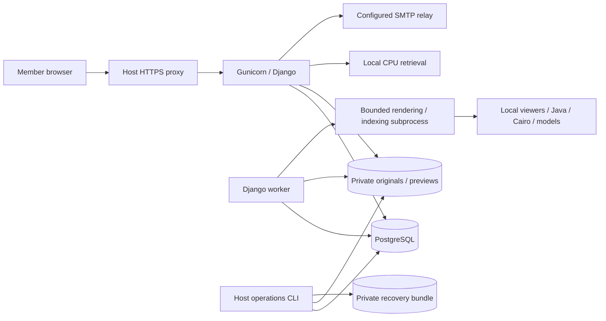

# UBSI portal — Architecture and maintenance

Recorded: 2026-10-12. This describes the implementation through M7, not a production deployment. Functional authority: [SPEC-001](../specs/SPEC-001-project-knowledge-portal.md). Delivery state and remaining acceptance: [documentation index](../README.md) and [M7](../qualification/M7-integrated-acceptance-and-operations.md).

## 1. System boundary

The application is one Django project with a PostgreSQL database and a shared private filesystem. Gunicorn serves server-rendered pages and protected file/API endpoints. A separate management-command worker prepares documents and semantic indexes. Vite bundles browser assets during builds; there is no Node runtime service. Public upstream assets/models are acquired and hash-verified at setup/build time; rendering and inference operate locally.

Browser assets are public code only. Originals, previews, qualification reports, account state and backups never become static assets. The existing `data/` → Excel/Release flow is independent. Importing applications is an explicit one-time draft operation, not live CSV synchronization.

## 2. Code map

| Location | Responsibility | Main boundary |
| --- | --- | --- |
| `portal/config/` | Environment validation, settings, routes and WSGI | Reject invalid production configuration before serving |
| `portal/core/` | Proxy/response middleware, health, assets and operational commands | Safe early responses and minimal anonymous health details |
| `portal/accounts/` | UUID accounts, invitations, recovery, sessions, rate limits | Fresh active/admin checks and serialized access mutations |
| `portal/knowledge/` | Typed schemas, editor, records, relations, import and publication | All visible changes pass through transactional services |
| `portal/sprints/` | Sprint activation/closure, validation and snapshots | One active sprint and immutable closure memory |
| `portal/documents/` | Upload policy, private storage, adapters and protected delivery | Immutable source bytes; ready previews required for publication |
| `portal/jobs/` | Durable queue, lease claims, worker and bounded child execution | At-least-once work with fenced completion |
| `portal/search/` | Current corpus, lexical search, semantic indexes, retrieval and activation | Current eligible sources only; qualification required for readers |
| `portal/templates/`, `portal/frontend/`, `portal/public/` | French server pages and focused local interactions | Server authorization/validation remains authoritative |
| `portal/acceptance/` | Isolated PostgreSQL engineering acceptance | Fictional accounts/files and real transaction/concurrency checks |
| `portal/scripts/` | Development initialization, artifact acquisition and host operations | Host recovery tooling is not copied into the runtime image |
| `qualification/` | M0 probes and M6 review materials | Technical exploration and qualification, not application runtime |
| `docs/qualification/` | Dated milestone reports and sanitized evidence | Preserve scope and failed observations |

The dependency/asset authority is `requirements.lock`, `package-lock.json`, `documents/assets.lock.json`, `search/assets.lock.json` and Docker image digests. [THIRD-PARTY.md](../../portal/THIRD-PARTY.md) records provenance/notices. Do not manually edit generated bundles or copy local model caches into Git.

## 3. Persistence and invariants

| Model family | Purpose and invariant |
| --- | --- |
| `User`, `LoginIdentity` | Stable business UUID; provider association is separate and GitHub OAuth is not implemented |
| `AccountControl`, `Invitation`, `RateBucket` | Serialize access lifecycle, store invitation digests and short-lived HMAC counters |
| `ProjectState`, `ApplicationCode` | Serialize project mutations, allocate references, retain code reservations and active sprint/search generation |
| `ContentRecord`, `ContentDraft`, `ContentRevision` | Stable identity, one working draft, immutable numbered publications and current pointer |
| `DraftRelation`, `RevisionRelation` | Typed relational links; publication validates current required targets |
| `SprintClosureSnapshot`, `SprintSnapshotRow`, `SprintSnapshotApplication` | Pre-closure membership/fields and historical application context |
| `FileRevision`, `Preview` | Immutable source metadata and separately prepared/versioned preview manifest |
| `Job` | Durable pending/running/done/failed/superseded state, attempts, lease and fencing token |
| `SearchPassage`, `SemanticIndex`, `SemanticChunk`, `RetrievalSlot` | Current lexical passages, revision/model-scoped indexes and bounded concurrent retrieval |

There are 30 applied framework/application migrations at the M7 checkpoint. PostgreSQL triggers enforce immutable history, relation guards and pointer ownership in addition to model/service checks. Do not bypass publication with ORM writes, generic admin edits or manual SQL. Historical authors/responsibles are retained when accounts become inactive.

Document original keys and preview prefixes live in private persistent storage. PostgreSQL transactions cannot atomically write that filesystem: staging, reference-aware cleanup and a quiesced two-store backup address that boundary. Never infer that a database-only dump is a complete portal backup.

## 4. Mutation paths

### Publication

1. Validate the active administrator and acquire account-control/project locks in the services' established order.
2. Check expected edit version, kind schema, typed links, current published parents, dependency rules and file readiness.
3. Insert an immutable revision and its relations, switch the current pointer, replace lexical passages and enqueue semantic work inside one transaction.
4. Commit. Readers observe a complete old or complete new publication. Editing/restoring drafts leaves the published pointer unchanged.

The shared project lock intentionally favors simple correctness for a small administrator group. Preserve lock ordering when adding services. Stale forms retain pending input; do not turn conflicts into unconditional overwrites. Required-parent archive checks protect current children; archiving also withdraws search eligibility.

### Sprint closure

The closure report records displayed versions of the sprint, members and planned targets. Closure rechecks the entire set and refuses unresolved member/sprint drafts. Every incomplete story needs an explicit backlog/report choice. Resulting story revisions, closed sprint revision and pre-change snapshot are committed together. Retried identical closure returns the existing outcome; a closed sprint cannot be reopened.

### Imported documents

Upload streams through a bounded handler into private storage, validates source/category policy and creates a draft-linked source plus job. The worker renders in an isolated bounded subprocess, installs derived assets only for a current lease, and records a ready or visible failure state. Admin publication requires the ready adapter. Replacement failure cannot replace a working published file. Every asset/original route rechecks its reader/draft/history context.

### Search and retrieval

Lexical search uses only current publications. Semantic work records the expected source revision/model and rechecks it before storing results. Retrieval checks eligibility and project generation again before responding. Signed source links include publication identity; replacing/archiving the source invalidates them.

Ranking uses E5 and the cross-encoder locally. `search/policy.py` is the experimental policy/fingerprint authority. Five database slots bound accepted retrieval work; a per-process lock bounds model access with a four-second wait. A source excerpt is stored text, not generated prose. Missing indexes, busy inference, no match and qualification pending are distinct outcomes.

## 5. Access and HTTP boundaries

- `/auth/`: sign-in, POST sign-out, invitation/recovery exchange and clean credential forms. `/` is the public sign-in entry and redirects authenticated users into the portal.
- `/applications/`, `/epics/`, `/stories/`, `/sprints/`, `/specifications/`, `/documents/`, `/faq/`: reader lists and UUID detail pages.
- `/search/`, `/assistant/`, `/assistant/query/`, `/assistant/source/<token>/`: current search and qualification-gated assistant/source navigation.
- `/admin/knowledge/`, `/admin/accounts/`, `/admin/sprints/`, `/admin/documents/`, `/admin/search/`: server-protected admin workflows. These are application views, not Django's generic model admin.
- `/documents/<uuid>/preview/`, `/download/`, `/frame/`, `/status/`, `/asset/<name>/`: authenticated current-file resolution. Separate admin draft/history routes are defined in `documents/urls.py`.
- `/health/live/`, `/health/ready/`: minimal public health results. Readiness also checks required assets/storage/migrations and qualified-model availability.

Private APIs return 401 when signed out; private HTML redirects to login without copying the private destination into query parameters. Reader administration is forbidden. Expected outcomes also include validation redisplay/422, stale state 409, upload bound 413, throttle/busy 429 and technical unavailability 503. See actual view/form contracts before integrating a client; this is not a versioned public REST API.

Response middleware applies private/no-store and restrictive security headers even to early access/CSRF failures. Viewer frames have dedicated policies. Trusted proxy handling runs before HTTPS logic and ignores untrusted forwarded headers. App logging deliberately avoids raw access URLs; production proxy and infrastructure logs require separate configuration.

## 6. Maintaining and qualifying changes

Use the [portal README](../../portal/README.md) for exact setup/build/management commands and the [runbook](../operations/PORTAL-RUNBOOK.md) for private operations. The runtime image contains application code/acceptance and acquired artifacts, but not host scripts or a real environment file. Rebuild after code changes; development Compose does not mount live sources.

| Change | Review together |
| --- | --- |
| New content kind or field | Schema/forms, service rules, projections/templates, migration guards, lexical/semantic extraction and acceptance |
| New relation/workflow | FK ownership, lock order, archive dependencies, version conflict behavior and snapshot history |
| New document adapter | Category/format validation, expansion/resource bounds, isolated rendering, CSP/delivery, exact original and historical restore |
| Authentication/provider | Stable UUID, explicit linking, role/revocation, bootstrap/last-admin, token/logging and SMTP behavior |
| Ranking/index/model | Artifact locks, source fences, policy fingerprint, new independent business evaluation and readiness |
| Deployment/recovery | Exact image, schema/private-volume consistency, secret handling, fresh-project restore and real-host measurements |

M7 has 49 distinct automated engineering checks: 45 pass in the runtime image; four host-script checks are skipped there and pass separately on the host. They cover role/publication/file boundaries, real PostgreSQL conflicts, hard worker crash/reclaim, format families, proxy handling and operational refusal paths. They do not qualify real answer adequacy or replace human accessibility/provider checks. CI declares the same engineering workflow; its remote execution is separate evidence from the recorded local runs.

The local load command is for an explicitly isolated fictional environment only. It temporarily creates accounts/sessions and cleans them up; it does not activate the reader assistant. The operational audit is read-only, but its complete output can reveal private inventory on a real deployment and must stay private.

## 7. Decision references and open handoff

[ADR-005](../adr/005-application-platform-and-private-access.md) covers platform/access; [ADR-006](../adr/006-publication-history-and-sprint-transactions.md) covers publication/sprints; [ADR-007](../adr/007-private-documents-and-durable-jobs.md) covers files/jobs; [ADR-008](../adr/008-grounded-retrieval-and-qualification-gate.md) covers retrieval; [ADR-009](../adr/009-deployment-backup-and-operational-acceptance.md) covers operations.

Do not mark SPEC-001 complete or enable reader retrieval from engineering checks alone. Outstanding work is owner-supplied urbanist-reviewed UBSI questions, independent quality evaluation, representative private files, broader keyboard/browser/assistive-technology review and real-host SMTP/TLS/load/off-host recovery. No hosting platform or GitHub authentication rollout has been approved by these technical records.
