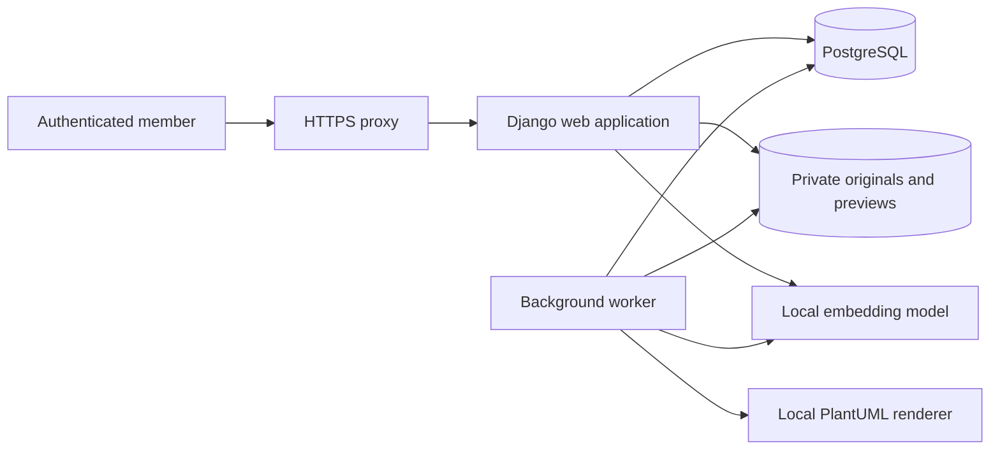

# PLAN-001: Implement the UBSI project knowledge portal

Status: M0–M5 completed locally; M6 integration implemented, urbanist qualification pending; M7 local engineering acceptance and operations prepared, final acceptance pending hosting and business inputs

Created: 2026-10-11

Functional baseline: [SPEC-001 — ready](../specs/SPEC-001-project-knowledge-portal.md)

Project decision: [ADR-003](../adr/003-project-knowledge-portal.md)

As-built platform, publication, document/job, retrieval and operational decisions are recorded in ADR-005 through ADR-009; see the [documentation index](../README.md). The [architecture reference](../architecture/PORTAL-ARCHITECTURE.md) maps the delivered modules and invariants, and the [usage guide](../guides/PORTAL-USAGE.md) covers reader/admin workflows. Historical milestone reports retain their original checkpoint scope.

## 1. Outcome and execution rules

Deliver the complete private portal described in SPEC-001 for the 46-member UBSI team: invitation-only accounts, reader/admin views, applications, cross-application epics and stories, shared sprints, visual specification pages, revisioned documents with previews, FAQ and a chatbot that links to published answers.

This document is the implementation plan. Functional specifications were approved on 2026-10-11 and the owner then authorized milestone execution. M0 produced local technical probes and the [qualification report](../qualification/M0-technical-qualification.md). M1 created the application foundation in `portal/`; its [completion report](../qualification/M1-application-foundation.md) records the local build, PostgreSQL migrations and UI evidence. M2 adds private access and account lifecycle; its [local report](../qualification/M2-private-access.md) distinguishes browser observations, service operations and remaining acceptance work. M3 adds the revisioned knowledge core, visual editor and initial application import; its [local report](../qualification/M3-revisioned-knowledge.md) records the implemented lifecycle, browser observations and remaining integrated acceptance work. M4 adds cross-application epics/stories and sprint activation/closure with immutable snapshots; its [local report](../qualification/M4-backlog-and-sprints.md) distinguishes observed scenarios from concurrency and integrated acceptance work. M5 adds private imports, all approved preview families, exact originals and historical file restoration; its [local report](../qualification/M5-imported-documents.md) records the observed source families and delivery/lifecycle limits. The baseline below incorporates [ADR-004](../adr/004-m0-preview-and-retrieval-decisions.md) and remains subject to the concrete hosting environment.

Implement directly on `main`, with small Conventional Commits referencing SPEC-001. Keep `data/`, `files/` and the current Release distribution operational. Runtime accounts, uploaded files, model caches, database dumps and secrets stay outside the public repository. Existing untracked spreadsheet/inspection files are not part of the portal change.

## 2. Recommended architecture

Use one Python application with a PostgreSQL database, private filesystem storage and one background worker. Render pages on the server and add focused browser interactions. This keeps account management, publication and access rules in one application, while reusing Python expertise and the repository's existing spreadsheet dependency.

| Concern | Proposed technology | Purpose and constraint |
| --- | --- | --- |
| Application | Python 3.12, Django 5.2 LTS, latest supported security patch when implementation starts | Models, forms, sessions, server rendering and transactional services. Django 5.2 has extended support through April 2028. [Django support policy](https://www.djangoproject.com/download/) |
| Database | PostgreSQL 17, current supported minor patch | Store records, immutable revisions, relationships, accounts, search and jobs. PostgreSQL 17 is supported through November 2029. [PostgreSQL version policy](https://www.postgresql.org/support/versioning/) |
| Browser UI | Django templates, CSS and locally bundled HTMX | Navigation, filtering, forms, preview polling and progressive updates. [HTMX documentation](https://htmx.org/docs/) |
| Visual editor | Tiptap community editor with local TypeScript/Vite bundle | Headings, lists, links, tables and code blocks; persist structured editor JSON and render it through an allowlisted schema. [Vanilla JS integration](https://tiptap.dev/docs/editor/getting-started/install/vanilla-javascript), [table extension](https://tiptap.dev/docs/editor/extensions/nodes/table) |
| Authentication | Django authentication, database sessions and a custom email-based user model | Invitation workflow and role checks are project services around framework authentication. [Django authentication](https://docs.djangoproject.com/en/5.2/topics/auth/default/) |
| File storage | Private persistent filesystem behind an application storage adapter | Originals and derived previews; no public media directory or public object URLs |
| Background work | One Django management-command worker, PostgreSQL job table | Validate/prepare previews and create semantic indexes without a separate queue broker |
| Text search | PostgreSQL French full-text search | Reader search and lexical chatbot candidates. [Django PostgreSQL search](https://docs.djangoproject.com/en/5.2/ref/contrib/postgres/search/) |
| Semantic search | Locally loaded `intfloat/multilingual-e5-small` through Sentence Transformers | Candidate passage matching on CPU; no answer-generation service or paid API. Qualification is mandatory. [Model card](https://huggingface.co/intfloat/multilingual-e5-small) |
| Production serving | Gunicorn and the host's HTTPS reverse proxy | One origin for pages, protected file endpoints and local static assets |
| Packaging | Docker Compose reference deployment; equivalent native services documented if containers are unavailable | Build frontend assets once; Node is not required as a production application process |

Pin exact dependency versions and asset/model revisions during M0/M1, record licenses and retain required notices. The Python portal has its own dependency lock so the existing CSV export is not coupled to web dependencies. No cloud subscription, paid Tiptap feature, external diagram renderer or paid model API is required.



The model node represents a pinned model artifact used by web and worker processes, not an externally hosted API. Start with one web process using threads and one worker; qualify memory/CPU use before choosing process counts. Reader/admin views share the same application and role checks.

## 3. Hosting discovery and local development

Hosting is provided but unspecified. Development and local qualification can proceed before access is available. Production deployment needs the following confirmed capabilities:

| Input from hosting provider | Required information |
| --- | --- |
| Execution | Linux/server environment, container support or ability to supervise Python web/worker processes; Java with the built-in Smetana engine for PlantUML; Graphviz only if an additional qualified layout requires it |
| Resources | CPU, RAM, persistent disk quota, process/time limits and ability to install model artifacts |
| Database | Supported PostgreSQL instance or permission to run one; database backup/restore access |
| Files | Private persistent storage shared by web and worker, outside the webroot |
| Email | SMTP transport, sender identity and credentials for invitations/password recovery |
| Network | Domain, HTTPS termination, reverse proxy/body-size settings, private service ports and permitted outbound access during setup |
| Operations | Backup destination, available restore space, service restart/log access and named infrastructure operator |

Use 2 vCPU and 4 GiB RAM as an initial sizing hypothesis, not a measured minimum or a promise. Measure the web/model/worker peak together. Estimate disk from original files, every retained published revision, previews, model artifacts and backup retention; the 20 MiB per-upload cap does not define total storage needs.

An environment limited to static pages cannot supply the approved authentication, private files and administrative writes. If hosting cannot run this architecture, revise the technical plan before deployment. Do not silently reduce functionality or substitute a paid provider. SMTP or another agreed private delivery mechanism must work before real invitations/recovery are enabled; console email is development-only.

## 4. Repository layout

Create the application in `portal/` so the current export scripts remain independent:

```text
docs/specs/SPEC-001-project-knowledge-portal.md
docs/plans/PLAN-001-project-knowledge-portal.md
portal/
  manage.py
  requirements.in
  requirements.lock
  package.json
  package-lock.json
  config/                 settings, URLs, WSGI, environment validation
  accounts/               users, sessions, invitations, password recovery
  knowledge/              records, drafts, revisions, relations, publication
  sprints/                activation, closure, snapshots and carry-over
  documents/              upload validation, private storage, preview adapters
  search/                 passages, lexical/semantic retrieval, chatbot policy
  jobs/                   durable jobs, leases, retry and worker command
  templates/              French reader/admin pages and reusable components
  frontend/               CSS, editor, document viewers, chatbot interactions
  acceptance/             isolated PostgreSQL engineering and concurrency checks
  Dockerfile
  compose.yaml
  .env.example            variable names and safe placeholders only
  README.md               setup, development, operator commands
```

Generated browser assets, private upload directories, model caches and test output are ignored. Synthetic fixtures can be versioned; actual user accounts/questions and private project documents cannot. Required frontend vendor assets are bundled at pinned revisions or acquired reproducibly at build time, with license notices; browsers must not fetch them from public CDNs.

## 5. Persistence and domain boundaries

### 5.1 Versioned content

Use a shared revision mechanism for applications, epics, stories, sprints, specifications, documents and FAQ. Keep per-kind validation explicit rather than accepting arbitrary JSON.

| Model | Main fields and invariants |
| --- | --- |
| `ProjectState` | One UBSI row used to serialize publication/relationship/sprint transitions; stores active sprint and a search-generation counter |
| `ContentRecord` | UUID, content kind, stable reference code, publication state, current published-revision pointer, creation metadata; unique reference |
| `ContentDraft` | One working draft per record, expected edit version, title, validated scalar/editor payload, optional responsible-user FK; mutable only through draft services |
| `ContentRevision` | Record FK, monotonically increasing revision number, title, schema-validated payload, optional responsible-user FK, author and publication timestamp; immutable |
| `DraftRelation` / `RevisionRelation` | FK to draft/revision and target record, relation kind; no relationships hidden as unvalidated UUIDs in JSON |
| `ApplicationCode` | Unique reserved application code and owning record; preserve prior codes as aliases when a rename is published, without changing record URLs |
| `FileRevision` | Immutable original storage key, SHA-256, filename, MIME/type, size, source category, preview manifest and processing state |
| `SearchPassage` | Source record/revision, section identifier, exact published excerpt, search vector, optional normalized embedding and model revision |
| `Job` | Kind, source revision, idempotency key, state, attempt count, lease and next-run time; durable at-least-once execution |
| `SprintClosureSnapshot` / `SprintSnapshotRow` | Closed sprint revision and pre-closure story revisions, preserving membership/state separately from current assignments |

Scalar/editor payload schemas are defined per content kind. Relations such as application membership, story parent epic, current sprint, dependencies and related documents are database foreign keys. Queries for readers start from the current published revision; they never load a draft and strip fields afterward. Live relation queries join through those published pointers.

Use UUIDs in canonical URLs. Human references use `EPIC-001`, `US-001`, `SPRINT-001`, `SPEC-001`, `DOC-001` and `FAQ-001`, increasing beyond three digits as needed; application codes preserve the existing CSV codes. Reference allocation is transactional and codes are not reused. Portal `SPEC-*` references are portal content, while this repository's SPEC-001 remains a development document.

Keep content-kind schemas, authorization, reader projections and publication rules in separate functions/modules. Views call these services; direct generic Django-admin writes must not bypass them. Do not expose a production generic model editor for revisioned content.

### 5.2 Publication transaction

Implement `save_draft`, `publish`, `restore_to_draft`, `archive` and `discard_unpublished_draft` as explicit operations:

1. Check the active account/admin role and expected draft version. Return a conflict for stale edits, retaining the administrator's pending input.
2. Within a database transaction, lock `ProjectState` and the relevant record/draft. This coarse lock is an intentional simplification for a small team with few concurrent administrators.
3. Validate the complete payload, required published targets, application subset, dependency acyclicity, unique codes and ready file previews. Revalidate dependencies under the lock.
4. Copy the draft and relations to an immutable published revision; update the current pointer and any reserved application code.
5. Replace lexical search passages in the same transaction and enqueue semantic-index work in the durable job table in that transaction. Do not rely only on an after-commit callback that can lose a job if the process crashes.
6. Commit all database changes together. Readers see the old or new complete revision.

When semantic embeddings are not ready, exclude older revisions and report temporary chatbot unavailability where necessary. An older indexed answer must never stand in for the new text. Index jobs verify that their revision is still current before storing results. Archiving immediately makes source records ineligible; retained historical passages cannot pass the final visibility check.

Files are written to private staging before their metadata transaction. Only validated, immutable, ready file revisions can be published. Cleanup removes abandoned staging objects and unreferenced files after a grace period; a reference check prevents removal of any retained published/history/draft file.

### 5.3 Sprint transaction

Store work progress independently from publication state. All progress and assignment changes still create published revisions when made visible to readers.

Activation locks `ProjectState`, validates dates/owner and assigned published stories, and rejects an existing active sprint. Closure locks the sprint and assigned stories, rejects unresolved drafts affecting the snapshot, and builds the snapshot from their current published revisions before altering assignments.

The closure screen must account for every incomplete story. Returning to backlog clears the current sprint and sets work state to `backlog`; carrying over sets the selected planned sprint while preserving work state. Finished/cancelled stories have their current assignment cleared. Create the affected story revisions, the closed sprint revision and snapshot in one transaction. A retried close request returns the completed outcome rather than closing twice. Readers see snapshot fields through the closed-sprint page, while canonical story links open the current published page.

## 6. Accounts, permissions and future GitHub sign-in

Create the custom user model in the first migration: UUID identity, unique normalized email, display name, password hash, `user`/`admin` role and active state. Use Django sessions and password APIs; choose Argon2 as the preferred password hasher with supported fallbacks. [Django password management](https://docs.djangoproject.com/en/5.2/topics/auth/passwords/)

Initial operational defaults:

- Invitations expire after 72 hours; recovery links after one hour. Both are single-use. Store a digest of a cryptographically random invitation token; redact raw invitation/reset tokens from logs.
- Require at least 12 password characters and apply Django common-password/user-similarity validators. Let framework validators reject invalid input; do not invent password hashing or recovery cryptography.
- Sessions expire after 12 hours. Use secure, HTTP-only, same-site cookies, CSRF protection and same-origin redirect validation.
- Check active account and role on every private request. Deactivation and role changes affect existing sessions immediately; password changes invalidate prior sessions.
- Rate-limit sign-in and recovery requests by account and source, and chatbot requests per member. Use PostgreSQL-backed short-lived counters initially; exact rate values are configuration, with explicit retry messages.
- Provision the initial administrator through an interactive management command. Never provide a shared default password, a public bootstrap endpoint or real credentials in fixtures.
- Send invitations/recovery through the configured mail transport. Show actionable delivery failures; an administrator can resend an invitation, invalidating its prior token. Mail failure must not silently create an active account.

For later GitHub sign-in, retain a `LoginIdentity(user, provider, provider_subject)` boundary with a unique provider/subject pair. Account linking must require an authenticated existing account or an explicit ownership-verification flow; it does not create a new business identity or infer administrator rights from GitHub email. OAuth integration itself is a later milestone, not part of initial delivery.

## 7. Frontend, routes and operation contracts

Use a consistent French interface: application sidebar/navigation, breadcrumb trail, clear publication/work-state badges, reader detail pages and dedicated admin forms. On smaller screens, lists/tables remain scrollable and the navigation collapses. Provide visible loading, empty, validation and service-error states.

| Route group | Operations |
| --- | --- |
| `/auth/` | Sign-in, POST sign-out, invitation acceptance, password reset request/confirmation |
| `/applications/`, `/epics/`, `/stories/`, `/sprints/`, `/specifications/`, `/documents/`, `/faq/` | Published lists, filters and canonical detail pages using UUIDs |
| `/admin/knowledge/` | Create/save drafts, reader preview, explicit publication, restoration, archive and draft discard |
| `/admin/sprints/` | Start and close with explicit story dispositions |
| `/admin/accounts/` | Invite, resend, deactivate/reactivate and manage roles with last-admin protection |
| `/documents/<id>/preview/` and `/documents/<id>/download/` | Resolve the currently published file and authorize every access |
| `/admin/documents/<id>/revisions/<revision>/` | Admin-only preview/download of historical file revisions |
| `/assistant/query/` | Authenticated JSON question endpoint; session-only chat UI |

Use form POSTs/HTMX for most writes. Where JSON is used, expose validated request shapes and consistent outcomes: `401` for signed-out API requests, `403` for forbidden actions, `404` for unavailable content, `409` for revision/state conflicts, `413` for upload limits and `429` for throttling. Server forms can redisplay field errors; JSON validation uses `422` with field-level messages. Page requests redirect signed-out visitors to sign-in without embedding private details in redirect parameters.

The implemented M6 chatbot request contains only `question` (maximum 500 characters and the model token budget). Its response has a status, a display message and source cards with title, reference, section, exact excerpt and a signed current-revision URL. The experimental candidate returns at most one source; the approved functional upper bound remains three. `qualification_pending`, invalid input and throttling are distinguished from `answer`, `no_answer` and technical `unavailable`. Questions are not stored in diagnostic logs. Business adequacy and multi-source needs remain part of the open M6 qualification.

Tiptap JSON is validated server-side against an allowlist. Generate reader HTML, exact plain-text passages and section anchors from the same canonical structure. Keep section UUIDs when a heading label changes. Render links with safe URL schemes and escape text; raw HTML/scripts and remote document embeds are not accepted. Form draft state must survive a conflict so the administrator can recover their edits.

## 8. Document preparation and preview adapters

Build the common import pipeline before individual viewers: private upload, extension/signature/schema checks, size/complexity limits, immutable original, queued preparation, preview manifest and publish eligibility. Use one adapter interface returning page/sheet metadata and private derived assets. The original download always returns the exact bytes verified by the stored digest.

| Source | Implementation approach | Qualification required |
| --- | --- | --- |
| Native `.drawio` / validated draw.io XML | Decode bounded compressed/uncompressed page data, validate XML and build a page manifest. Use the pinned local draw.io viewer **and matching stencil bundle**, with page/zoom controls in an opaque sandboxed viewer frame. [Official embedded formats](https://www.drawio.com/docs/manual/export/embed-diagram/), [viewer source](https://github.com/jgraph/drawio/blob/dev/src/main/webapp/js/viewer-static.min.js) | Multi-page files, HTML labels, stencils and embedded images; editing/cloud actions disabled; no external resource fetches. M0 qualified representative local shapes; M5 must validate complete source/adapter readiness, additional libraries and private delivery. |
| `.xlsx` | Read with `openpyxl`, producing sheet manifests and paginated cell data. Use stored results and retain formula metadata separately. [Reader API](https://openpyxl.readthedocs.io/en/stable/api/openpyxl.reader.excel.html) | Inspect bounded raw worksheet XML to distinguish absent cached results from genuinely empty results; preserve dates/numbers/simple styles, hidden-sheet labels and the approved limits |
| `.csv` | UTF-8/BOM decoding, bounded delimiter detection plus administrator override; quoted values supported | Semicolon/comma/tab, embedded newlines, ambiguous separators and inconsistent row structures |
| `.puml` / `.plantuml` | Local headless Java renderer using `SANDBOX` and `-Playout=smetana`, with a bounded subprocess and private temporary directory. Graphviz is optional and requires separate qualification. Convert outputs into safe viewer assets. [PlantUML security profiles](https://plantuml.com/security) | M0 rendered class/entity diagrams and multiple blocks without Graphviz, refused includes and exercised timeout termination. M5 must integrate failure/readiness and resource bounds. |
| `.pdf` | Validate page count/structure server-side; locally bundled PDF.js in a restricted viewer frame with scripting disabled. [PDF.js](https://mozilla.github.io/pdf.js/), [pypdf](https://pypdf.readthedocs.io/en/stable/) | Multi-page navigation, encrypted/unsupported PDFs, excessive complexity and links/scripts |
| PNG/JPEG | Decode/re-encode a preview image with bounded pixel dimensions; retain untouched original | Invalid files and decompression/pixel-size abuse |
| SVG | Parse/sanitize an allowlist and rasterize a derived preview with local CairoSVG; preserve SVG original only for authenticated attachment download. [CairoSVG](https://github.com/Kozea/CairoSVG) | No scripts, external resources, entities or active foreign content; reject sources that cannot be represented safely |

Viewer frames have a restrictive content security policy and no editing privileges. Vendor scripts, fonts and supporting assets are served locally. Validate isolation as part of M0: local vendoring alone does not prove a third-party viewer performs no external fetches. Do not use a public diagrams.net/PlantUML service or put private source data in public share links.

The worker uses time/memory limits for parsers/renderers, cleans temporary files, and records safe failure codes. Start with a 60-second job execution bound and qualify the preview adapters under the approved file limits. An unsupported complex source fails visibly; it is not silently truncated or published without its required preview. M0 engineering defaults: 16 million raster pixels, 8,000 pixels per side, 20-second PlantUML timeout, 256 MiB Java heap and 8 MiB expanded draw.io XML per page. Keep them configurable and validate them against representative sources and the final host; see the [M0 evidence and limitations](../qualification/M0-technical-qualification.md).

Jobs are claimed using transactional row locking, have a lease, and retry transient errors at most three times with backoff. Format errors are permanent until a corrected source is supplied. Jobs are idempotent by source digest, adapter version and preview options. Restarting a worker must not duplicate file revisions or publish a draft. Django supports `select_for_update()` for transactional locking; use PostgreSQL-specific transaction tests for this behavior. [QuerySet locking](https://docs.djangoproject.com/en/5.2/ref/models/querysets/#select-for-update)

## 9. Search and chatbot retrieval

Implement source retrieval and source-card formatting as separate components. The source gate always checks active account, published state, current revision and eligible content kind. Imported-file text, archives, drafts and account data are never candidates.

### 9.1 Indexing

Extract passages from the canonical published text, retaining title, question/aliases for FAQ, section anchor, revision and exact offsets/excerpt. Do not merge text across unrelated sources. Create French full-text vectors at publication. Semantic jobs build normalized local embeddings for those same passages.

Start with a maximum of 350 model tokens per passage and 50-token overlap within a section. Add the source title/FAQ question within the model's input budget; keep the excerpt grounded in the original published body. The E5 model uses 384-dimensional embeddings, a 512-token limit and `query: `/`passage: ` prefixes, including non-English inputs. Its MIT license and usage contract are documented in the [model card](https://huggingface.co/intfloat/multilingual-e5-small).

Store embeddings with source revision and model identifier in PostgreSQL arrays or binary fields. For the initial corpus, compute exact cosine rankings over eligible vectors with NumPy; no vector-database extension is required. Measure corpus size and latency in M0/M7. If the corpus outgrows this approach, propose an indexed vector backend without changing the source/permission contract. Warm a single model instance per process; avoid loading one copy per request.

### 9.2 Query and abstention

1. Validate input and active session; apply rate/concurrency limits. Do not persist the submitted question or embed it in diagnostic logs.
2. Rank exact FAQ aliases, French lexical candidates and semantic candidates, preserving source revision and section information. Merge/deduplicate by source section.
3. Apply calibrated minimum adequacy and ambiguity rules. A high similarity score alone does not establish that a passage answers a question or that two passages agree.
4. Return at most three independently adequate source cards with exact excerpts and links. Do not generate a new combined business answer.
5. When no source is adequate or ambiguity/conflict is apparent, return the approved urbanists message. When search is not functioning or current indexing is incomplete, return `unavailable` where a genuine no-answer conclusion cannot be made.
6. Recheck source revision and visibility immediately before sending the response. Resolve clicked links against current authorized content.

Candidate ranking cannot guarantee correctness or reliably detect every contradiction. Qualification must specifically cover negation, opposite rules, similar keywords with no answer and stale passages. If the selected model/policy fails these cases, improve retrieval or adopt a more conservative abstention policy before declaring the chatbot complete. Do not treat embeddings as a contradiction detector or ship keyword matching alone while claiming the paraphrase requirement is met.

### 9.3 Qualification dataset

Build a versioned synthetic/anonymized evaluation fixture with answerable FAQ/spec questions, paraphrases, unknown questions, misleading keyword overlaps, contradictory passages and draft/archived/file-only cases. Urbanists review representative expected source destinations. Keep calibration and held-out evaluation questions separate; start with at least 30 questions in each group.

Freeze the retrieval policy after calibration. Initial acceptance target: correct destination in the returned source cards for at least 90% of answerable held-out questions, no returned source for held-out questions labelled unanswerable/conflicting, and no private/stale-source disclosure. Report actual counts and errors; these finite-sample targets are not a guarantee for all future questions. New failures require a documented policy change and additional independent evaluation cases.

### 9.4 M0 findings and M6 acceptance gate

M0 demonstrated offline E5 CPU execution and an optional multilingual cross-encoder reranking experiment. E5 alone returned 6/18 correct destinations on its held-out questions. Reranking returned 16/18 on 30 new evaluation questions, but failed the earlier regression set with incorrect/inappropriate sources. Neither measured score/margin policy is accepted for production. Detailed counts, policies, timing and raw error cases are preserved in the [M0 report](../qualification/M0-technical-qualification.md).

M1 can proceed with the common application foundation. Before M6 is complete, improve adequacy/ambiguity handling, retain all observed failures as regressions, freeze the new policy, and pass a new independent evaluation with urbanist-reviewed expectations. Do not weaken the 90%/zero inappropriate-source targets or use either probe as the final chatbot. Reranking is a measured candidate, not a mandatory production dependency or an answer generator.

## 10. Delivery milestones

The order is based on dependencies. Each milestone yields reviewable behavior or evidence. Relative effort is a planning aid (`S`, `M`, `L`), not a delivery-date commitment.

| Milestone | Depends on | Work and deliverable | Completion evidence | Effort |
| --- | --- | --- | --- | --- |
| M0 — qualify technical choices | Ready SPEC-001 | Select pinned versions/assets; qualify native draw.io isolation, all preview families, Excel cached-result distinctions and CPU semantic retrieval; record hosting unknowns and measured resource needs | Small disposable technical probes with synthetic files; technical notes resolving adapter/model feasibility; no public upload or deployment | M |
| M1 — application foundation | M0 architecture viable | Add `portal/`, PostgreSQL migrations, configuration validation, local Compose environment, asset build, French page shell and CI | Clean local setup, database migration, asset build, health/readiness endpoints and unchanged CSV export | S |
| M2 — private access | M1 | Custom user, bootstrap, invitations, password recovery, session/role guards and account-management UI | Reader/admin/signed-out access matrix including file stubs; deactivation and last-admin protection validated | M |
| M3 — revisioned knowledge core | M2 | Content/draft/revision schemas, relations, conflict handling, publish/archive/restore, application import, specification editor, FAQ CRUD and reader lists/details | Drafts never leak; old published text survives draft edits; restore creates a draft; CSV import is idempotent and cannot overwrite later portal edits | L |
| M4 — backlog and sprints | M3 | Epic/story forms, application relationships, work states, dependencies, sprint pages, activation/closure and historical snapshots | Complete cross-application epic/story flow; concurrent activation rejected; carry-over and unchanged closure history demonstrated | M |
| M5 — imported documents | M3; M0 adapters | Shared upload/job/storage pipeline, every approved preview adapter, original downloads, replacement/history and private viewer frames | All source families import/preview/download; old originals remain admin-only; invalid/oversized sources fail without changing the live document | L |
| M6 — search and chatbot | M3, M0 retrieval | Published search, lexical/semantic indexing, source-card chat UI, abstention, revision checks and evaluation fixtures | FAQ/spec paraphrases retrieve expected sources; unknown/draft/file-only/archived/stale cases abstain or report unavailability correctly | M |
| M7 — integrated acceptance and operations | M4, M5, M6 | End-to-end checks, mobile/keyboard review, load qualification, backup/restore, deployment/runbook and real-host adaptation | SPEC-001 acceptance matrix completed; restore rehearsal passes; provider prerequisites confirmed before production launch | M |

Execution checkpoint, 2026-10-12: **M0 completed** with 40/40 format probes, 16/16 boundary probes and browser preview evidence. The retrieval experiments expose a mandatory M6 acceptance gate. **M1 completed locally** with locked dependencies, a Linux ARM64 container build, PostgreSQL 17.11, 16 applied migrations, Django/drift checks, local assets, health/readiness HTTP 200, a French development shell and unchanged CSV export. **M2 completed locally** with 18 applied migrations, interactive bootstrap, invitations/recovery, role/session enforcement, throttling and dedicated account administration. Synthetic-account observations covered readers/admins/signed-out visitors, file guards, last-admin refusal, session revocation and SMTP failure; see the M2 report for scope limits. A separate portal CI workflow is added but has not run remotely. **M3 completed locally** with 22 applied migrations, immutable revisions/typed relations, conflict recovery, explicit publication/archive/restore, one-time non-overwriting application import, the locally bundled visual specification editor and FAQ. Reader/admin and desktop/mobile observations used isolated fictional content; publication replaces lexical passages and enqueues durable semantic jobs without shipping a worker or chatbot. See the M3 report for scope limits. **M4 completed locally** with 25 applied migrations, structured epic/story forms, application-subset and dependency-cycle validation, one active sprint, explicit activation/closure, carry-over/backlog decisions and immutable closure rows. Sequential refusal/retry, stale-balance, draft, withdrawal, reader/admin and desktop/mobile scenarios were observed with fictional data; simultaneous concurrency/load remains acceptance work. **M5 completed locally** with 29 applied migrations, private immutable originals, local viewers, leased and bounded preview preparation, explicit ready-only publication, replacement/history and original downloads. Fictional service/browser observations cover approved source families, absent versus empty formula caches, CSV override/pagination, unsafe and oversized replacements, archive and reader/history restrictions. Measured 390px workbook/diagram pages, keyboard table scrolling and mobile menu navigation were observed; the wider accessibility/device matrix remains M7 work. Worker-crash/concurrency/load and the full acceptance matrix remain M7 work. **M6 integration implemented locally** with 30 migrations, published cross-content search, offline semantic preparation, hybrid candidate ranking, ephemeral source-card chat, revision-aware clicked links and a reader activation gate. The owner chose to supply UBSI questions and expected destinations before qualification; no new retrieval acceptance score is claimed. See the [M6 report](../qualification/M6-search-and-chatbot.md). **M6 acceptance remains open. M7 local engineering acceptance and operations have proceeded at the owner’s request**, with isolated PostgreSQL checks, concurrency/worker recovery, format delivery, read-only file integrity audit, 46-session loopback measurements, a fresh-project backup/restore rehearsal and provider deployment guidance. Hosting remains to be specified. The [M7 report](../qualification/M7-integrated-acceptance-and-operations.md) separates local evidence from business, assistive-technology and provider acceptance still pending. This checkpoint does not mark the assembled portal's functional acceptance scenarios complete. Probe reproduction commands are in [qualification/README.md](../../qualification/README.md); application startup commands are in [portal/README.md](../../portal/README.md).

M4 and M5 can be implemented sequentially in either order after M3; this plan does not require multiple developers or agents. M0 evidence can expose a need to revise a technical choice; record the reason and preserve the approved functional contract. Do not replace full format support or access control with a demonstration-only shortcut.

## 11. Verification and continuous integration

During implementation, add targeted tests for the domain/security rules and real integration points. Verify transaction behavior against PostgreSQL, not SQLite. Browser checks cover meaningful user flows rather than duplicating every model assertion.

| Coverage | Checks |
| --- | --- |
| Authorization | Reader/admin/signed-out requests, direct writes, draft snippets, originals, previews, historical file URLs, archive behavior and account deactivation |
| Publication | Immutable revisions, expected draft version, published-parent validation, application subset, dependency cycles, invalid restore and concurrent publish/archive |
| Sprints | Simultaneous activation, closure retry, carry-over conflicts, rejected ambiguous drafts and snapshot stability after later story edits |
| Files | Representative file per format, multiple sheets/pages, malformed/over-limit data, genuine empty versus missing formula cache, unsafe SVG/PlantUML resources, worker restart and original-file digest |
| Editor/UI | Visual structures survive save/render, safe link handling, stable heading anchors, recoverable edit conflict, keyboard forms and responsive lists/viewers |
| Retrieval | Separate calibration/held-out results; exact/paraphrased/unknown/conflicting questions; no draft/file/archive input; index staleness and service failure distinct from no-answer |
| Operations | Account email delivery in staging, no sensitive request/token logs, backup consistency, restore rehearsal and qualification resource/latency measurements |

Map SPEC-001 acceptance scenarios to milestones: AC-01/02/13/14 → M2 plus regression checks in M5/M6; AC-03/04/15/18 → M4; AC-05/06/16/17/20/22 → M3; AC-07/08/09/19/21 → M5; AC-10/11/12 → M6, with archive/access regressions across the full application. M7 reruns the complete relevant suite once against the assembled release.

Add a portal CI workflow scoped to `portal/**` and its own workflow file. On `main`, run dependency installation from locks, Django checks/migration-drift checks, targeted PostgreSQL tests and frontend build/type checks. Add the focused browser scenarios once a runnable UI exists. Run the existing CSV conversion before commits that touch code, in accordance with repository rules. Preserve the existing Release workflow's path scope; code-only portal changes must not publish generated private assets or documents as Release attachments.

Planned commands, available after M1 creates their inputs:

```text
python scripts/csv_to_xlsx.py
docker compose -f portal/compose.yaml up --build
python portal/manage.py check
python portal/manage.py makemigrations --check --dry-run
python portal/manage.py test
npm --prefix portal ci
npm --prefix portal run typecheck
npm --prefix portal run build
```

Add commands for focused browser checks, retrieval evaluation and backup restoration when those tools are implemented. Do not claim the future suite, source adapters or load targets have been verified during this planning task.

## 12. Deployment, backups and handover

The reference deployment has `web`, `worker` and `db` services plus the provider's reverse proxy, private data volumes and a pinned model artifact. Java/Cairo dependencies belong to the worker image; Graphviz is optional for separately qualified layouts. Frontend assets are compiled during the build. Expose only the HTTPS application entry point; PostgreSQL, private originals and worker controls are not public services.

The configuration template documents `DATABASE_URL`, framework/session secrets, allowed host/origin settings, private storage paths, SMTP transport, model path/revision and preview limits. Real values enter the host's secret/environment mechanism. A deployment startup check rejects missing production secrets, debug mode or public/private storage overlap.

Production rollout sequence:

1. Confirm host/runtime/storage/email/HTTPS/backup prerequisites and record the actual resource envelope.
2. Build locked application/assets/model artifacts and run the release checks.
3. Take a consistent backup before migrations when updating an existing environment. Stop writes and wait for active preparation jobs when required to make a filesystem/database backup coherent.
4. Apply migrations, start web/worker, verify readiness and initialize the first administrator interactively.
5. Run the one-time application import with a dry-run report, then let an administrator publish the directory. No private documents or real users are auto-imported from the public repo.
6. Validate invitation/recovery delivery and private file access with authorized staging accounts. Populate project content through the approved admin workflow.
7. Enable the production entry point and execute a short authenticated smoke check. Record the release commit and operator instructions.

Back up a coherent database/file set daily, keeping seven daily and four weekly restore points as specified. Use a provider-approved backup destination separate from the application's live data; never GitHub/public Releases. Model assets and static builds are reproducible artifacts, while original files and content history are irreplaceable runtime data. Rehearse restoration before initial launch and document the measured restoration time.

Rollback is a documented operation: use backward-compatible migrations where possible; otherwise restore the matching database/file backup with the previous application artifact. Reverting source alone is insufficient after an incompatible schema/data change. Stop deployment if health checks, account delivery, private storage or restore validation fails; development can continue locally while the infrastructure issue is resolved.

## 13. First implementation step and completion criteria

M0–M5 are complete locally. M6 integration and M7 local engineering/operational preparation are delivered; continue with owner-supplied UBSI questions/expected sources, independent qualification and retained M0 regressions before enabling readers or closing M6. Finish real-host adaptation, representative-source and assistive-technology acceptance before closing M7 or launching. The proposed synthetic fixture is not approved business evidence. Retain the M2 access guards and M3/M5 publication boundaries. The unknown host affects production adaptation, not local implementation.

The first release is complete when all approved content types and preview formats work; reader/admin authorization and publication/history rules pass their checks; sprint snapshots survive later changes; the chatbot passes the agreed source-selection evaluation; and the available host has working persistent storage, account delivery, HTTPS, backups and a demonstrated restore procedure. No partial milestone alone constitutes completion of SPEC-001.
